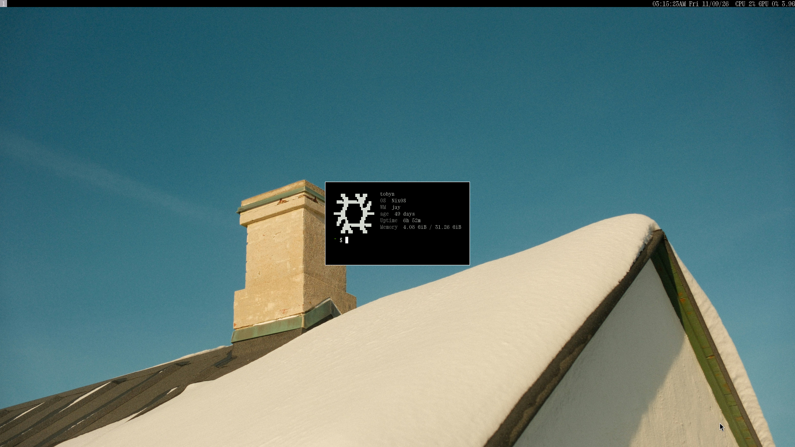

# nixos-config

NixOS flake for a dual-monitor Wayland desktop. Compositor is **jay**
(launched via **ly**), terminal is **foot**, browser is **helium**.
Everything is monochrome: black/white GTK theme, Papirus-Dark icons,
XanhMono font.

## Layout

```
flake.nix            # inputs: nixpkgs-unstable, home-manager, helium, spicetify, agenix
hosts/nixos/         # host config + hardware-configuration.nix
modules/system/      # base, graphics, nvidia, compositors, apps, gaming, media, vpn
modules/user/        # home-manager extras (spotify via spicetify)
home.nix             # user env: zsh, gtk theme, dotfile symlinks
dotfiles/            # jay, foot, fastfetch, rofi, starship, i3status-rs, waywall, ...
assets/wallpapers/   # wallpapers (active: "snowy house.jpg")
secrets/             # agenix secrets (surfshark wireguard key)
```

## How it's configured

- **Compositor (`dotfiles/jay/config.toml`):** jay on NVIDIA (Vulkan,
  `0x10de:0x2489`). Left monitor 120Hz, right 165Hz. i3bar-style bar
  driven by i3status-rs. Startup apps: swaybg, policykit agent, thunar
  daemon, cliphist watchers, qpwgraph, keymapper, gamma relay.
- **Shell (`home.nix` -> zsh):** zsh with autosuggestions,
  syntax highlighting, starship prompt, and fastfetch on every new
  shell. Two perf tweaks keep new terminals ~30ms:
  - `compinit -C` reuses the completion dump instead of rescanning the
    nix store (~700ms -> ~10ms). After installing something with new
    completions, refresh once with `compinit -d ~/.zcompdump`.
  - fastfetch ships without the `packages` module (counting NixOS
    packages cost 74ms alone). Age/uptime/memory stay live.
- **Terminal (`dotfiles/foot/foot.ini`):** floating 44x10 window,
  XanhMono italic, pure black/white, no CSD, no scrollback indicator.
- **Browser:** helium with telemetry/stripped flags
  (`--disable-background-networking`, `--disable-sync`, etc.).
- **Gaming (`modules/system/gaming.nix`):** Steam + steam-hardware,
  gamescope, gamemode, ntsync, performance governor. Waywall +
  Ninjabrain-Bot for Minecraft speedrunning.
- **Audio/media:** EasyEffects (`Super+Shift+E` toggles),
  playerctl media keys, Spotify via spicetify.
- **VPN (`modules/system/vpn.nix`):** Surfshark Wireguard (key via
  agenix): `vpn-uk`, `vpn-nl`, `vpn-us`, `vpn-off`.
- **Screenshots:** `Super+F12` copies a region to clipboard,
  `Super+Shift+F12` also saves to `~/Screenshots/`.

## Keybinds (`logo` = Super)

| Keys | Action |
|---|---|
| `Super+T` | foot terminal (floating) |
| `Super+E` | thunar file manager |
| `Super+B` | helium browser |
| `Super+Space` | rofi app launcher |
| `Super+V` | clipboard history (cliphist + rofi) |
| `Ctrl+Shift+Tab` | btop (floating) |
| `Super+F` | toggle floating |
| `Super+Shift+Q` | close window |
| `Super+A/D/W/S` | focus left/right/up/down |
| `Super+Shift+A/D/W/S` | move window |
| `Super+1..0` / `Super+Shift+1..0` | workspaces / move to workspace |
| `Super+F5/F6` | brightness down/up (repeatable) |
| `Super+F12` / `Super+Shift+F12` | screenshot region (clipboard / + file) |
| `Super+Shift+E` | toggle EasyEffects |
| `F7/F8/F9` | prev / play-pause / next |
| `Alt+Shift+R` | reload jay config |
| Volume/mute/mic keys | pipewire via `wpctl` |

## Shell aliases

| Alias | Command |
|---|---|
| `rebuild` | `sudo nixos-rebuild switch --flake /etc/nixos#nixos` |
| `update` | flake update + rebuild |
| `vpn-uk/nl/us/off` | start/stop Surfshark tunnels |
| `ssh-pi` | ssh to the Pi |
| `commit [msg]` | `git add -A && git commit && git push` |

## Rebuild

```bash
rebuild
```

Then `Alt+Shift+R` to reload the compositor config (or re-log for
session-level changes like systemd user units).

## Desktop


